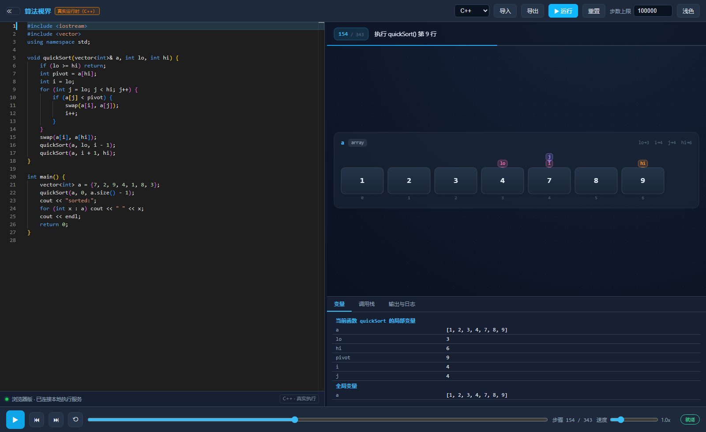
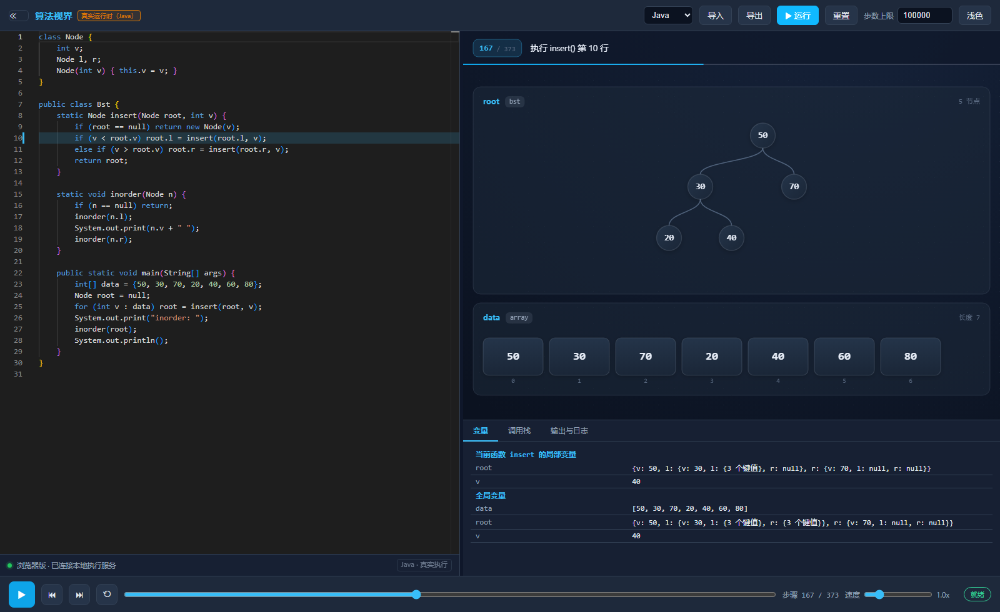
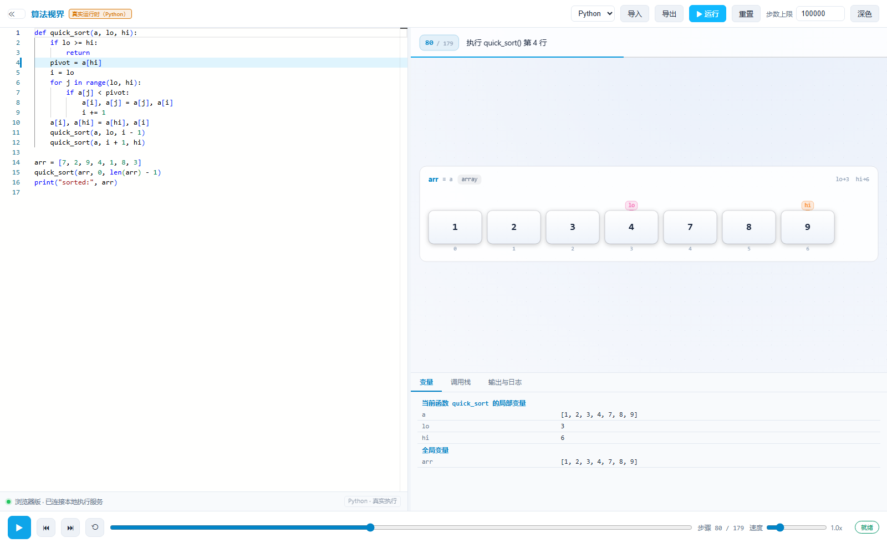

# 算法视界 · AlgoView

**写代码，看动画。** 左侧 Monaco 编辑器，右侧 Canvas 画布 —— 把数组、链表、树、图的每一步变化真实地画出来。

与常见「算法可视化」最大的区别：**不预置示例、不模拟执行**。编辑器默认是空的，你写什么就跑什么；
Python / Java / C / C++ 都调用你本机的解释器和编译器真实执行，再通过各自的调试接口逐步追踪，
把每一步的真实内存状态交给画布渲染。



---

## 它到底不一样在哪

| 常见做法 | 算法视界 |
|---|---|
| 预置几十个示例，只能改参数，不能自由写代码 | 编辑器默认空白，零预置示例 |
| 浏览器里实现一套「教学子集」解释器，语法稍复杂就报错 | 调用本机解释器 / 编译器 / 调试器，跑的是完整语言 |
| 动画由脚本编排，不是程序真实状态 | 每一步来自被调试进程的真实内存快照 |
| 指针、引用、泛型、标准库容器基本无法表达 | f-string、泛型、`std::vector`、指针、递归照常可用 |
| 看起来在演示算法，其实在播放预录画面 | 数组、链表、树、图由变量结构自动识别，无需写注解 |

---

## 快速开始

需要 **Node.js 18+**。

```bash
git clone https://github.com/sun050819/algoview.git   # 换成你的仓库地址
cd algoview
npm install
npm run build
node server/bridge.cjs
```

浏览器会自动打开 `http://127.0.0.1:5321/`。

Windows 也可以直接双击仓库根目录的 **`start.cmd`**：它会在第一次运行时自动装依赖、构建，然后起服务。
服务窗口关掉应用就用不了了，请保持它开着。

> **为什么必须有本地服务？** 浏览器里没有编译器和调试器。要"真实运行"，
> 就必须落到本机进程上：页面把代码 POST 给本地服务，服务调编译器执行并逐步追踪，
> 再把统一的事件流回传给页面播放。

---

## 四种语言，三套追踪器

每门语言都用**它自己生态里最正统的调试接口**，而不是另造一个解释器。代价是必须装对应工具链，
换来的是语法完整、状态真实。

| 语言 | 追踪方式 | 需要装什么 |
|---|---|---|
| Python | `sys.settrace` 逐行钩子，导出栈帧局部变量 + 模块级全局快照 | Python 3.8+ |
| Java | `javac -g` 编译 → JDWP 挂起 JVM → 自写 JavaTracer 通过 JDI 逐行读栈 | JDK 8+（`javac` / `java` 在 PATH） |
| C / C++ | `gcc/g++ -g -O0` → GDB/MI2 单步，指针差还原容器长度 | MinGW-w64（`gcc` / `g++` / `gdb`） |

启动窗口会逐条打印四种语言是否就绪（`✓` / `✗`），缺哪个只影响那一门。
页面左下角也有同样的状态条，连不上时可以点「重试」。

MinGW 没进 PATH 也没关系：`runtime/toolchain.cjs` 会遍历各盘符下的常规安装位置
（Dev-C++ / MSYS2 / MinGW-w64），也可以用 `DSA_MINGW_DIR`、`DSA_GCC`、`DSA_GDB` 显式指定。

---

## 能画出什么

不需要任何标注或注解，程序里的数据结构会被自动识别：

- **数组 / vector / list** —— 盒子序列带下标；`i / j / lo / hi / mid` 这类下标变量会画成上方游标
- **二维数字数组** → 邻接矩阵图；**数组的数组** → 邻接表图
- **单 / 双向链表**（`next`、`prev` 字段）→ 节点链与箭头，环形链表自动绕回
- **二叉树**（`left/right` 或 `l/r` 字段）→ 分层树 + 贝塞尔连线
- **字典 / Map / HashMap** → 键值卡片

操作高亮：比较（红）、写入（绿）、交换（琥珀，带位移）、新建节点（紫）。
内容超过一屏时自动等比缩放，保证一屏看得全。



三个状态页签：**变量**（局部 + 全局）、**调用栈**、**输出与日志**。
底部控制条支持播放/暂停、单步前进后退、0.1x–5x 变速、进度条任意跳转。



---

## 架构

```
代码 ──POST /run──▶ 本机编译器/解释器 ──逐步追踪──▶ 原始事件
                                                      │
                                          统一 StepEvent 事件流
                                                      │
            重放：前进=应用一个事件，后退/跳转=从头重放到目标步
                                                      │
                                          结构识别 → Canvas 渲染
```

**事件流是唯一事实源。** 所以回放和第一次播放永远一致，来回拖动进度条也不会错乱。

```
algoview/
├─ src/
│  ├─ core/events.ts        StepEvent 定义 + 事件重放
│  ├─ core/value.ts         可视化值类型
│  ├─ languages/            执行通道 + 四语言事件转换
│  ├─ store/appStore.ts     唯一状态源：运行 → 事件流 → 重放
│  ├─ ui/                   顶栏 / 编辑器 / 画布 / 状态面板 / 控制条
│  └─ visualizer/           结构识别 model.ts + Canvas 渲染 renderer.ts
├─ runtime/                 三套真实追踪器（被 spawn，不参与前端打包）
│  ├─ python-tracer.py      sys.settrace
│  ├─ JavaTracer.java       JDI 客户端
│  ├─ gdb-tracer.mjs        GDB/MI2 单步
│  └─ toolchain.cjs         工具链定位（不写死路径）
├─ server/
│  ├─ bridge.cjs            静态托管 + /health + POST /run
│  └─ runner.cjs            执行引擎：按语言分派到对应追踪器
├─ scripts/                 verify / e2e / 打包 / 冒烟测试
├─ build/installer.nsi      NSIS 安装脚本
├─ electron/                可选桌面外壳（Electron）
└─ docs/                    效果图
```

---

## 桌面版与离线包

```bash
npm run dist
```

产物：

| 文件 | 内容 |
|---|---|
| `AlgoView-Setup-1.0.0.exe` | NSIS 安装版：可选安装目录、桌面与开始菜单快捷方式、带卸载程序 |
| `AlgoView-Portable-1.0.0.zip` | 免安装绿色版：解压双击 `AlgoView.exe`，不写注册表 |
| `AlgoView-Web-Offline.zip` | Web 离线包：`dist/` + `server/` + `runtime/`，需 Node 18+，双击 `启动服务.cmd` |

输出目录：单独 clone 本仓库时写到 `artifacts/`；如果它放在个人主页站点里（同级有 `case/algo/`），
会写进站点的下载目录。打包需要本机有 `electron` / `electron-builder` 缓存或能联网下载。

---

## 校验

```bash
npm run typecheck   # TypeScript 零错误
npm run verify      # 四语言真实执行 + 结构识别 + 回放确定性 + 错误透传（7 项）
npm run test:engine # 不经过浏览器，直接冒烟测执行引擎（四语言）
```

浏览器端到端（需先启动服务）：

```bash
node scripts/e2e.mjs py python scripts/fixtures/quicksort.py
```

---

## 已知限制

- 追踪器统一按 **5 万步** 上限保护（Java 另有 8 秒超时）；递归很深、循环很多的长程序会被自动终止。
- C/C++ 的数组长度靠指针与长度变量推断；`std::vector` 通过内部指针还原，非 libstdc++ 实现（如 MSVC STL）需另行适配。
- C/C++ 的「全局变量」面板取的是 `main` 里出现过的容器变量；文件作用域的标量全局暂不采样。
- 自定义 `struct` 之间靠指针串联的复杂图结构，目前识别为链表/树，尚未做通用图布局。
- 只支持单文件程序；C/C++ 的 `#include` 走本机头文件。

---

## 关于路径

所有定位都是"就地推算"，没有任何写死的绝对路径，所以仓库可以放在任意盘符、任意子目录：

| 需要什么 | 怎么定位 | 可覆盖 |
|---|---|---|
| 前端产物 / 追踪器 | 相对于 `server/bridge.cjs` | — |
| 支持站点（可选） | 向上找同时有 `index.html` 与 `case/` 的那一层 | `DSA_SITE_DIR` |
| 本地服务端口 | 默认 5321 | `DSA_BRIDGE_PORT` / `?bridge=` |
| MinGW 工具链 | 环境变量 → PATH → 各盘常规布局 | `DSA_MINGW_DIR` / `DSA_GCC` / `DSA_GDB` |

前端构建用 `base: './'`，产物里的资源引用全是相对路径。

---

## 出处

本项目同时是个人作品集「Search & Verify」的第 06 号作品，配套介绍页见个人主页的 `case/algo/`。

## License

[MIT](LICENSE) © 2026 孙继晨 (Sun Jichen)
